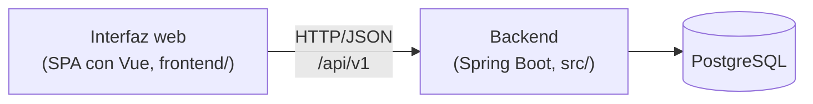
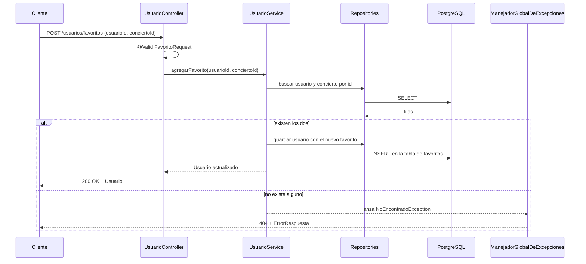

# Arquitectura del sistema

Este documento es la referencia de arquitectura del proyecto. La wiki
enlaza aquí en lugar de tener su propia copia: si cambia algo de la
arquitectura, se actualiza este archivo en el mismo PR.

## Visión general

El sistema tiene tres piezas que se comunican por HTTP (ver ADR-001,
ADR-002 y ADR-003):



- La **interfaz** solo habla con la API por HTTP. No tiene acceso a la
  base de datos ni a las clases del backend.
- El **backend** concentra toda la lógica de negocio, las validaciones y
  el acceso a datos. Es la fuente de verdad.
- El **contrato** `src/main/resources/static/openapi.yml` es el acuerdo
  entre las dos partes: si un endpoint cambia, primero se cambia el
  contrato.

## Backend

### Capas

El backend sigue una arquitectura en capas para separar
responsabilidades:

| Capa | Paquete | Responsabilidad |
| ---- | ------- | --------------- |
| Controller | `controller` | Recibe la petición HTTP, valida el cuerpo y llama al Service. No tiene lógica de negocio |
| Service | `service` | Reglas de negocio (por ejemplo, correo único o favoritos sin duplicados) |
| Repository | `repository` | Acceso a datos con Spring Data JPA |
| Model | `model` | Entidades (`Concierto`, `Usuario`) y cuerpos de petición (`RegistroRequest`, `FavoritoRequest`, `ConciertoRequest`) |
| Exception | `exception` | Excepciones del dominio y manejador global de errores |
| Config | `config` | Prefijo `/api/v1` y datos de prueba |

```
com.memelomanos.finderconciertos
├── FinderDeConciertosApplication.java   (clase principal de Spring Boot)
├── config/
├── controller/
├── service/
├── repository/
├── model/
└── exception/
```

Las entidades y sus relaciones están descritas en la página
[Modelo de datos](https://github.com/SE-7003-2027/memelomanos-finder-de-conciertos/wiki/Modelo-de-datos)
de la wiki.

### Flujo de una petición

Ejemplo: marcar un concierto como favorito
(`POST /api/v1/usuarios/favoritos`).



### Manejo de errores

`ManejadorGlobalDeExcepciones` traduce las excepciones a respuestas HTTP
con un formato común (`ErrorRespuesta`: `status`, `error`, `mensaje`,
`timestamp`). Sin él, cualquier excepción llegaría al cliente como un
`500` genérico.

| Excepción | Respuesta |
| --------- | --------- |
| `UsuarioNoEncontradoException`, `ConciertoNoEncontradoException` | `404 Not Found` |
| `CorreoDuplicadoException` | `409 Conflict` |
| `MethodArgumentNotValidException` (falla `@Valid`) | `400 Bad Request` |
| `MissingServletRequestParameterException` (falta un parámetro) | `400 Bad Request` |
| `HttpMessageNotReadableException` (JSON mal formado o de tipo incorrecto) | `400 Bad Request` |

Para agregar un caso nuevo, crea la excepción en `exception/` y añade un
`@ExceptionHandler` en el manejador.

### Prefijo `/api/v1`

Los controllers no repiten `/api/v1` en sus rutas: `WebConfig` lo agrega
a todos los controllers del paquete `controller`. Se limita a ese
paquete a propósito, porque aplicarlo a todos los `@RestController`
movería también los endpoints internos de springdoc y Swagger UI dejaría
de funcionar. Esto también facilita publicar una `/api/v2` sin romper la
v1.

### Contrato OpenAPI y código generado

Swagger UI lee el contrato de `src/main/resources/static/openapi.yml`
(configurado en `application.yml`) y lo muestra en
http://localhost:8080/swagger-ui/index.html.

El `pom.xml` también configura `openapi-generator-maven-plugin`, que
genera interfaces y modelos en `target/generated-sources` (paquetes
`com.memelomanos.conciertos.api` y `com.memelomanos.conciertos.model`).
Sin embargo, los controllers del proyecto están escritos a mano y **no
implementan** esas interfaces, y las entidades reales son las del paquete
`com.memelomanos.finderconciertos.model`. En la práctica, el contrato y
el código se mantienen sincronizados a mano: al cambiar un endpoint hay
que actualizar los dos.

## Interfaz (SPA con Vue)

La interfaz vive en la carpeta `frontend/` y está construida con Vue 3,
Vue Router y Vite (ver ADR-002).

```
frontend/src/
├── api/          cliente HTTP compartido y una función por endpoint
├── stores/       estado compartido, como el usuario actual y sus favoritos
├── views/        una vista por ruta
├── components/   piezas reutilizables, como BotonFavorito
├── router/       rutas de la aplicación
└── utils/        fechas y validaciones
```

- **Llamadas a la API:** todas pasan por `src/api/cliente.js`, que
  antepone `/api/v1`, envía y recibe JSON, y convierte las respuestas de
  error en un `ErrorApi` con el `status` y el `mensaje` del backend. Las
  vistas usan las funciones de `src/api/` y no llaman a `fetch`
  directamente. Cuando exista el login, el token se agregará solo en ese
  archivo.
- **Usuario actual:** mientras no haya login, `src/stores/usuario.js`
  guarda el usuario elegido al registrarse o al entrar con su correo, y
  solo conserva su `id` en `localStorage`.
- **Comunicación con el backend en desarrollo:** el backend corre en el
  puerto `8080` y Vite en el `5173`. El proxy de Vite
  (`server.proxy` en `vite.config.js`) reenvía `/api` al backend, así que
  el navegador no necesita CORS. Para un despliegue con orígenes
  distintos hará falta configurar CORS en el backend (#55).

## Pendientes de arquitectura

Las decisiones abiertas (autenticación, migraciones de base de datos,
origen de los datos y despliegue) están listadas en la página
[Decisiones de arquitectura](https://github.com/SE-7003-2027/memelomanos-finder-de-conciertos/wiki/Decisiones-de-arquitectura)
de la wiki.
